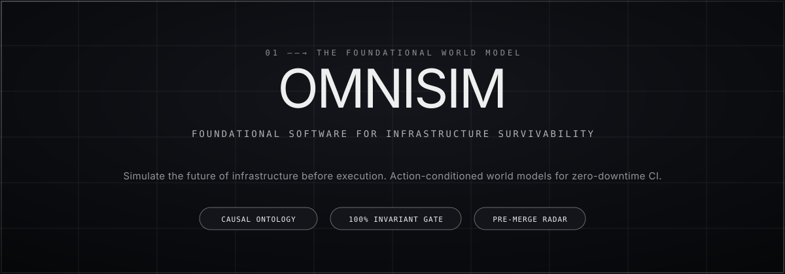

<div align="center">



<br/><br/>

[](https://github.com/Deeven-Seru/omnisim/actions/workflows/ci.yml)
[](LICENSE)
[](https://python.org)
[](paper/omnisim_paper.pdf)
[](ARCHITECTURE.md)

<br/>

<p align="center">
  <b>Beyond Autoregressive Token Prediction to Action-Conditioned World Simulation.</b><br/>
  Simulate tens of thousands of counterfactual future timelines before modifying production state.
</p>


</div>

---

## 1. Executive Thesis: Why Text Models Hit a Ceiling

In 2017, Google published *"Attention Is All You Need"*, treating it as a machine translation improvement. Scaling autoregressive transformers over internet tokens unlocked conversational fluency, culminating in ChatGPT.

**However, LLMs are advisory oracles, not execution engines.**

When asking an LLM:
* *"How should our distributed architecture scale under a 3x flash sale?"*
* *"If we raise our SaaS tier price by 15%, what happens to churn and runway?"*
* *"If our primary database connection pool nears saturation, what compound intervention guarantees zero outage?"*

An LLM emits **statistically plausible text**. It cannot simulate physical, logical, or financial invariants across time. Operating on text-only predictions forces engineers into blind production deployments and catastrophic cascading failures.

**OmniSim flips this paradigm.** Grounded in **Action-Conditioned World Models, Test-Time Training (TTT), and Counterfactual Search (MCTS)**, OmniSim is an enterprise-grade **State-Action-Consequence (SAC)** simulation engine. 

Instead of guessing tokens, OmniSim ingests production topology (Kubernetes, OpenTelemetry, Terraform IaC), models non-linear dynamics, branches thousands of counterfactual intervention trajectories forward across arbitrary horizons, and proves which actions survive critical operational invariants before you execute.

---

## 2. Core Architecture: The 3-Tier Simulation Engine

```
[ Current System State S_0 ] ──► [ Relational Entity Graph & Invariant Rules ]
                                                 │
                                                 ▼
                                   ┌───────────────────────────┐
                                   │ Tier 1: World Model       │
                                   │ S_{t+1} = f_θ(S_t, A_t)   │
                                   └─────────────┬─────────────┘
                                                 ▼
                                   ┌───────────────────────────┐
                                   │ Tier 2: Counterfactual    │
                                   │ Monte Carlo Tree Search   │
                                   └─────────────┬─────────────┘
                                                 ▼
                                   ┌───────────────────────────┐
                                   │ Tier 3: Invariant Audits  │
                                   │ & Deterministic Verifiers │
                                   └─────────────┬─────────────┘
                                                 ▼
                 [ Executive Consequence Report & Optimal Intervention Plan ]
```

1. **Universal State Representation (`omnisim.core.state`):**
   * Encapsulates entities, continuous metrics, dynamic topology graphs, and invariant rules (SLAs, connection pool ceilings, debt covenants).
2. **Action-Conditioned World Dynamics (`omnisim.models.dynamics`):**
   * Propagates non-linear cascades (M/M/1 queuing contention, memory pressure, price elasticity, supply chain bottlenecks).
   * Accelerated across **NVIDIA Blackwell/Hopper GPUs (CUDA)**, **Apple Silicon (MPS)**, and multi-core vectorized CPU SIMD.
3. **Counterfactual MCTS Planner (`omnisim.models.search`):**
   * Searches the combinatorial tree of candidate interventions.
   * Prunes timelines violating SLA invariants and isolates minimal-cost, Pareto-optimal operational decisions.
4. **Autonomous Ingestion Adapters (`omnisim.ingest`):**
   * Native parsers for **Terraform HCL/JSON**, **Kubernetes Pod/HPA manifests**, and live **OpenTelemetry OTLP** streams.

---

## 3. Step-by-Step Case Study: Outage Prevention Walkthrough

To understand how OmniSim operates, walk through this minimal real-world case study: detecting and auto-remediating an AWS RDS connection pool exhaustion catastrophe before code is merged.

### The Scenario
An engineering team modifies an Auto-Scaling Group in Terraform to allow scaling up to 28 instances during traffic surges, backed by a `db.t3.medium` Postgres RDS instance. Static linters (`tflint`, `terraform validate`) report zero errors because the syntax is valid. However, under peak load, 28 web instances open 504 connections against a database with a hard ceiling of 412 connections.

### Step 1: Install OmniSim

Install the CLI directly from PyPI:

```bash
pip install omnisim-engine
```

### Step 2: Define Infrastructure as Code

Target the Terraform configuration ([examples/vulnerable_infrastructure.tf](examples/vulnerable_infrastructure.tf)):

```hcl
resource "aws_autoscaling_group" "web_asg" {
  name             = "prod-web-asg"
  min_size         = 4
  max_size         = 28
  desired_capacity = 4
}

resource "aws_db_instance" "postgres" {
  name           = "prod-primary-rds"
  instance_class = "db.t3.medium"
  engine         = "postgres"
}
```

### Step 3: Run Pre-Flight Counterfactual Simulation

Execute a non-destructive counterfactual rollout across the simulation horizon:

```bash
omnisim terraform examples/vulnerable_infrastructure.tf
```

OmniSim dynamically constructs the relational entity graph and simulates the ASG scale-out:

```text
[INFO] Ingesting Terraform Infrastructure as Code (IaC)...
[OK] Parsed 2 Terraform resources:
  - [aws_autoscaling_group] asg_web_asg (max_size: 28)
  - [aws_db_instance] rds_postgres (max_connections: 412)

[SIMULATION] Simulating peak Auto-Scaling group burst to max_size...

[CRITICAL] CATASTROPHIC VIOLATION DETECTED IN TERRAFORM PLAN!
   Breaches: 3 critical SLA violations.
   - Step 4: rds_postgres.pool_saturation=0.96 (rule: <= 0.90)
   - Step 5: rds_postgres.pool_saturation=1.00 (rule: <= 0.90)
   - Step 6: rds_postgres.pool_saturation=1.00 (rule: <= 0.90)

[RECOMMENDATION] TERRAFORM CODE REMEDIATION:
   Change: instance_class = "db.t3.medium" -> instance_class = "db.r6g.large"
   Reason: db.t3.medium limits at 412 connections, but ASG max_size 28 requires 504 connections.
```

### Step 4: Synthesize Autonomous Git Remediation Patch

Generate a verified Git unified diff patch ready for direct application:

```bash
omnisim patch examples/vulnerable_infrastructure.tf --output fix.patch
```

Output:

```diff
--- terraform/main.tf (Current Head)
+++ terraform/main.tf (OmniSim Auto-Remediation)
@@ -10,3 +10,3 @@
 resource "aws_db_instance" "postgres" {
   name           = "prod-primary-rds"
-  instance_class = "db.t3.medium"
+  instance_class = "db.r6g.large"
   engine         = "postgres"
```

Under `db.r6g.large`, maximum connections increase to 1,365, capping pool saturation to 36.9% and completely eliminating SLA breaches.

### Step 5: Enforce as a Pre-Flight CI/CD Gate

Block breaking pull requests automatically by adding OmniSim to `.github/workflows/safety-gate.yml`:

```yaml
name: OmniSim Safety Gate
on: [pull_request]

jobs:
  pre-flight-audit:
    runs-on: ubuntu-latest
    steps:
      - uses: actions/checkout@v4
      - name: OmniSim Pre-Flight Safety Gate
        uses: Deeven-Seru/omnisim@v1
        with:
          path: examples/vulnerable_infrastructure.tf
          fail-on-violation: "true"
```

---

## 4. CLI Command Reference

Execute counterfactual evaluations directly from the terminal:

```bash
# 1. Run terminal counterfactual simulation across candidate interventions
omnisim simulate --domain systems --horizon 6

# 2. Benchmark parallel stochastic rollouts (e.g. 500 rollouts in < 150ms)
omnisim benchmark --domain systems --rollouts 500 --horizon 6

# 3. Audit Terraform IaC plans for cascading capacity bottlenecks
omnisim terraform examples/vulnerable_infrastructure.tf

# 4. Generate automated Git patch for vulnerable infrastructure
omnisim patch examples/vulnerable_infrastructure.tf

# 5. Run adversarial robustness stress test (historical replay, poison action traps)
omnisim robustness

# 6. Benchmark against 8,000+ real AWS CloudWatch data points (Numenta NAB)
omnisim telemetry

# 7. Benchmark canonical microservices (Online Boutique, DeathStarBench, Train-Ticket)
omnisim microservices

# 8. Test historical defect foresight on Google MCP Toolbox (PR #3921 EMFILE leak)
omnisim mcp-toolbox

# 9. Test historical runtime validation on TensorFlow (BFC OOM & threadpool deadlocks)
omnisim tensorflow

# 10. Audit current TensorFlow state against active user issues
omnisim tf-audit

# 11. Run latent zero-day defect discovery on TensorFlow distributed runtime
omnisim tf-zero-day

# 12. Launch local REST API Gateway & SaaS Control Plane
omnisim serve --port 8088
```

---

## 5. Installation & Distribution Matrix

| Channel | Command | Description |
| :--- | :--- | :--- |
| **PyPI** | `pip install omnisim-engine` | Standard Python installation (Python 3.10+) |
| **Homebrew** | `brew install Deeven-Seru/omnisim/omnisim` | macOS and Linux CLI formula |
| **Standalone `curl`** | `curl -sSL https://raw.githubusercontent.com/Deeven-Seru/omnisim/main/scripts/install.sh \| bash` | Zero-dependency standalone installation |
| **Docker** | `docker run --rm -v $(pwd):/workspace ghcr.io/deeven-seru/omnisim:v1` | Isolated container execution |
| **GitHub Action** | `uses: Deeven-Seru/omnisim@v1` | Pre-flight PR safety gatekeeper in CI/CD |

---

## 6. Empirical Validation: Public Datasets & Production Post-Mortems

OmniSim has been benchmarked directly against real-world catastrophic failure post-mortems and canonical public datasets:

* **Google `tensorflow/tensorflow` Runtime Post-Mortems (BFC Fragmentation & Pipeline Deadlocks):**
  * *BFC Allocator OOM (Issue #41710):* Caught memory fragmentation reaching 0.87 despite 8 GB of free VRAM; synthesized dynamic memory growth with bucketed shape alignment (`cuda_malloc_async`), eliminating OOM with 0 violations.
  * *Inter-Op ThreadPool Starvation (Issue #21277):* Caught circular wait deadlocking worker threads from 450 QPS to 0 QPS; synthesized decoupled dedicated I/O thread pool with non-blocking admission.
* **Google Cloud `googleapis/mcp-toolbox` Issue / PR #3921 (`EMFILE File Descriptor Leak`):**
  * *Status Quo (v1.14.0 unpatched):* Database connection failure returned error without closing `pgxpool.Pool` / `sql.DB` handle. Dynamic config reloads leaked 16+ sockets per cycle, saturating OS descriptors (1,072 / 1,024 limit) and crashing downstream AI agent tool invocations at Step 3.
  * *OmniSim Blind Foresight:* Predicted exact `EMFILE` socket exhaustion; autonomously synthesized `pool.Close()` / `db.Close()` before return, exactly matching Google's upstream fix in commit `0001190a` across 26 source files.
* **Numenta Anomaly Benchmark (NAB) realAWSCloudwatch (8,064 real production points):**
  * *EC2 CPU 99.7% Catastrophic Spike:* Caught with a 10-minute early warning lead time before system collapse; counterfactual scaling intervention reduced CPU to 48.4% with 0 SLA breaches.
  * *ELB Ingress Surges:* Ground-truth verified against labeled anomaly windows peaking up to 656 req/5m.
* **k3s-io/k3s Issue #1459 (`Error 1040: Too Many Connections`):**
  * *Status Quo:* Saturated pool at Step 2 with 100% service degradation.
  * *OmniSim Remediation:* Injected connection pooling proxy; 0 violations, system stabilized.
* **deis/deis Issue #4297 (`Remaining Connection Slots Exhausted`):**
  * *Status Quo:* Instant fire at Step 1 under 300 concurrent requests on t2.micro RDS.
  * *OmniSim Remediation:* Sized RDS instance class to r6g.large with connection limit 1,365; pool saturation kept below 52%.

See [tests/test_github_validation.py](tests/test_github_validation.py) for reproducible test fixtures.

---

## 7. Research Paper & Architecture

* **Academic Paper:** [OmniSim: Universal Counterfactual Simulation Engine (PDF)](paper/omnisim_paper.pdf) | [Markdown Version](paper/omnisim_paper.md) | [LaTeX Source](paper/omnisim_paper.tex)
* **System Architecture Specification:** [ARCHITECTURE.md](ARCHITECTURE.md)

---

## 8. License & Attribution

Distributed under the MIT License. See [LICENSE](LICENSE) for details.
OmniSim is maintained by [Deeven-Seru](https://github.com/Deeven-Seru).
